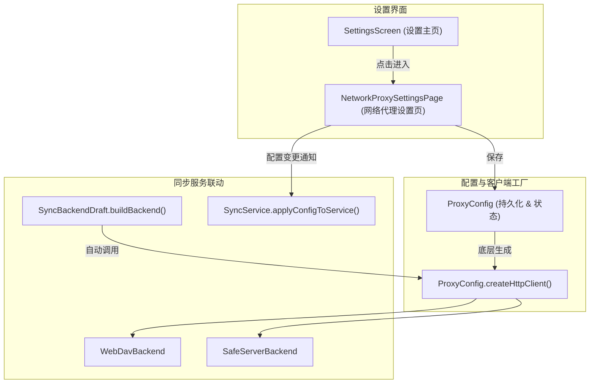

# 网络代理设置设计方案 (Network Proxy Design)

## 1. 背景与目标

CarroNote 具备多设备 E2EE 同步能力，支持 WebDAV 及自建 SafeServer 作为远端存储。
在某些网络环境（如内网环境、需要科学上网访问海外 WebDAV/网盘、或本地运行了代理工具如 Clash / v2ray / Surge）下，同步服务需要经由指定的 HTTP / SOCKS 代理连接远端服务器。

### 核心目标
1. **独立配置**：代理设置独立作为主设置页（Settings）的一个独立分组（Group），不与特定的同步后端表单混杂。
2. **自动生效**：在设置中开启并配置代理后，同步服务（WebDAV / SafeServer）自动使用该代理进行连接与数据传输。
3. **即改即用**：代理开关或地址变更时，若同步服务已处于运行状态，能够自动热重载底层连接，无需重启应用。
4. **格式兼容与健壮性**：支持多种常见输入格式（`127.0.0.1:7890`、`http://127.0.0.1:7890`、`socks5://127.0.0.1:1080`），并提供连通性测试能力与安全脱敏。

---

## 2. 总体架构

---

## 3. 详细设计

### 3.1 代理配置与客户端工厂 (`ProxyConfig`)

在 `lib/sync/proxy_config.dart`（或 `lib/data/proxy_config.dart`）中建立统一管理类：
- **持久化键值**（`SharedPreferences`）：
  - `network_proxy_enabled`（bool，默认 `false`）
  - `network_proxy_host_port`（String，如 `127.0.0.1:7890`）
- **客户端构建** (`ProxyConfig.createHttpClient()`)：
  - 若 `kIsWeb`、未开启代理、或代理地址为空，返回默认 `http.Client()`。
  - 在原生 IO 平台（Windows, macOS, Linux, Android, iOS），使用 `dart:io` 的 `HttpClient`，并设置 `findProxy`：
    - 支持解析 `host:port`、`http://`、`https://`、`socks5://`、`socks://`。
    - 转换为标准 PAC 返回值（如 `PROXY 127.0.0.1:7890;` 或 `SOCKS 127.0.0.1:1080;`）。
  - 设置 `connectionTimeout`（10秒），防止代理服务离线导致请求挂起。
- **脱敏日志**：
  - 提供 `redactProxyUrlForLog`，若用户输入包含 `user:pass@` 凭据，自动遮盖。

### 3.2 界面交互设计

1. **设置主页 (`lib/views/settings/settings.dart`)**：
   - 增加独立分区 `shadSectionTitle(context, 'Network'.tr())`。
   - 包含导航项 `Network Proxy`，副标题实时反映当前状态（`Off` / `127.0.0.1:7890`）。
2. **代理设置详情页 (`NetworkProxySettingsPage`)**：
   - **代理开关**：`shadSwitchTile`，一键开启/停用代理。
   - **代理地址输入框**：支持输入 `127.0.0.1:7890`。
   - **测试代理连通性**：提供“测试连接”按钮，使用当前配置发起一次受控轻量探测，给出明确反馈。
   - **Web 平台提示**：若运行于 Web 端，显示提示信息说明 Web 端网络受浏览器接管。

### 3.3 同步服务自动使用 (`SyncService` 联动)

1. **后端实例构造**：
   - 在 [`SyncBackendDraft.buildBackend()`](file:///c:/Home/Projects/carronote/lib/sync/sync_config.dart) 中，构建 `WebDavBackend` 和 `SafeServerBackend` 时，传入 `client: ProxyConfig.createHttpClient()`。
2. **同步测试连接**：
   - [`SyncService.testBackendConfig()`](file:///c:/Home/Projects/carronote/lib/sync/sync_service.dart) 构建的临时后端自动应用当前代理配置，测试结果真实反映当前网络路径。
3. **配置变更热生效**：
   - 当用户在代理设置页开启、关闭或修改代理并保存时，若 `SyncService.instance.state.isInitialized` 为真，主动调用 `SyncService.instance.applyConfigToService(...)`。
   - 旧后端的 HTTP client 被安全关闭（释放 TCP 句柄），新后端以最新代理 client 初始化。

---

## 4. 边界与安全性考量

1. **LocalFs 后端**：
   - 本地目录同步不涉及网络，不使用 HTTP Client，代理配置天然互不影响。
2. **PAC 语法要求**：
   - Dart `HttpClient.findProxy` 要求返回值符合 PAC 规范（必须有结尾分号，如 `PROXY host:port; DIRECT;` 或 `PROXY host:port;`）。
3. **敏感凭据脱敏**：
   - 代理地址打入任何日志前，必须掩盖 `user:pass`，防止泄露在诊断导出中。
4. **多语言支持**：
   - 补充 `zh-CN.json` 与 `en-US.json` 翻译。
